# Robot arm design package (DRAFT rev A)

Blueprints, dimensioned part drawings and the wiring schematic for the 4-DOF desktop robot arm
(5 lb payload, 39.4 in reach, never beyond 48 in). Everything here is **generated** by the Python code in
[`3d-workflow/arm/`](../../3d-workflow/arm); edit the sources and rerun, don't hand-edit the drawings.

| What | Source of truth | Rendered output |
|---|---|---|
| Part geometry | [`arm/hardware.py`](../../3d-workflow/arm/hardware.py) (`HW` dimensions) | [`cad/step/`](../../3d-workflow/design/cad/step), [`cad/stl/`](../../3d-workflow/design/cad/stl) |
| Drive sizing | [`arm/design.py`](../../3d-workflow/arm/design.py), [`arm/build.py`](../../3d-workflow/arm/build.py) | [`design.json`](../../3d-workflow/design/design.json), [`BOM.md`](../../3d-workflow/design/BOM.md) |
| Drawings and schematic | [`arm/drawings.py`](../../3d-workflow/arm/drawings.py) | [`drawings/*.svg`](../../3d-workflow/design/drawings), [`schematics/*.svg`](../../3d-workflow/design/schematics) |
| PNG previews | [`arm/render.py`](../../3d-workflow/arm/render.py) | [`png/*.png`](../../3d-workflow/design/png) |

Related: [assembly guide](../../3d-workflow/docs/ASSEMBLY.md), [wiring pin table](../../3d-workflow/docs/WIRING.md),
[firmware](../../3d-workflow/firmware/arm_controller/arm_controller.ino). Click any preview for the full-resolution SVG.

## System sheets

| Sheet | Preview |
|---|---|
| **ELE-001** wiring schematic: PSU, fuse, E-stop, Arduino Mega, 5 stepper drivers, 5 motors<br>[SVG](../../3d-workflow/design/schematics/ELE-001_wiring.svg) · [PNG](../../3d-workflow/design/png/ELE-001_wiring.png) | [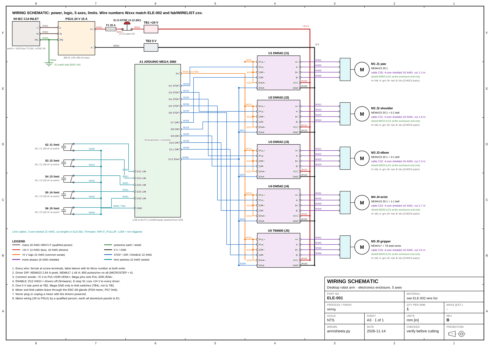](../../3d-workflow/design/schematics/ELE-001_wiring.svg) |
| **ASM-001** arm assembly elevation: link lengths, reach, worst-case pose<br>[SVG](../../3d-workflow/design/drawings/ASM-001_assembly.svg) · [PNG](../../3d-workflow/design/png/ASM-001_assembly.png) | [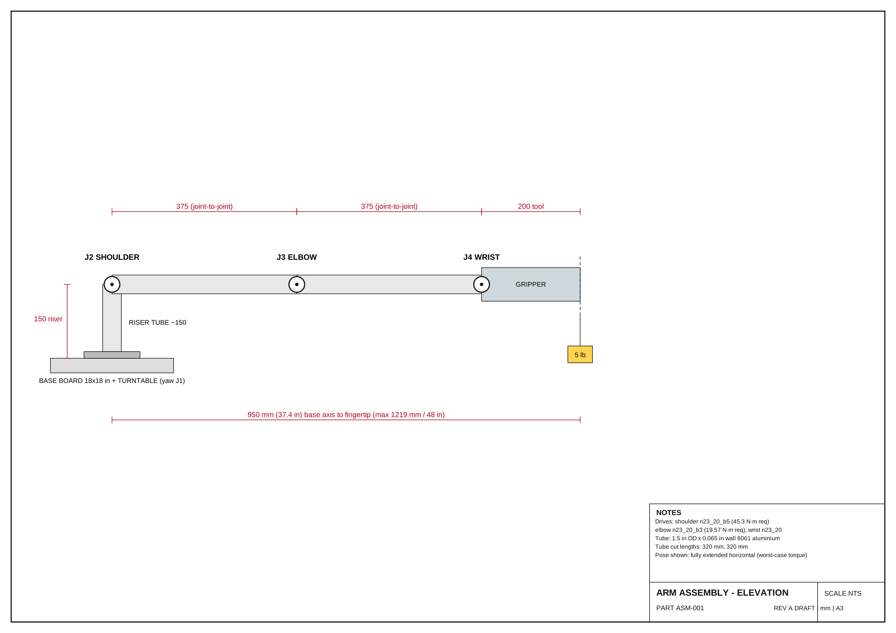](../../3d-workflow/design/drawings/ASM-001_assembly.svg) |
| **ASM-002** pitch-joint section: bearings, belt reduction, load path<br>[SVG](../../3d-workflow/design/drawings/ASM-002_joint_section.svg) · [PNG](../../3d-workflow/design/png/ASM-002_joint_section.png) | [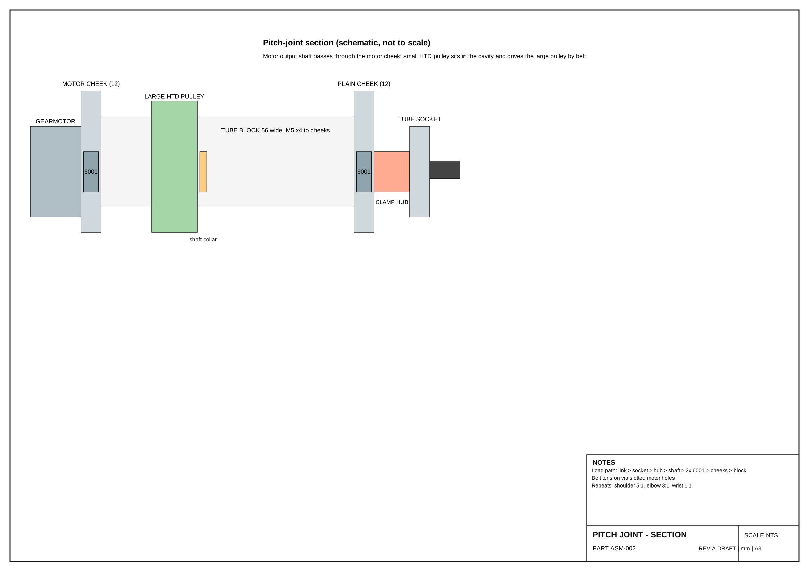](../../3d-workflow/design/drawings/ASM-002_joint_section.svg) |

## Printed parts

Each sheet is A3, third-angle, front/top/right views with overall dimensions. STEP for CAD/CAM, STL to slice.

| Part | Qty and files | Preview |
|---|---|---|
| **base_top_plate**<br>Rotating plate: yaw hub + turntable + riser socket | x1<br>[SVG](../../3d-workflow/design/drawings/base_top_plate.svg) · [PNG](../../3d-workflow/design/png/base_top_plate.png) · [STEP](../../3d-workflow/design/cad/step/base_top_plate.step) · [STL](../../3d-workflow/design/cad/stl/base_top_plate.stl) | [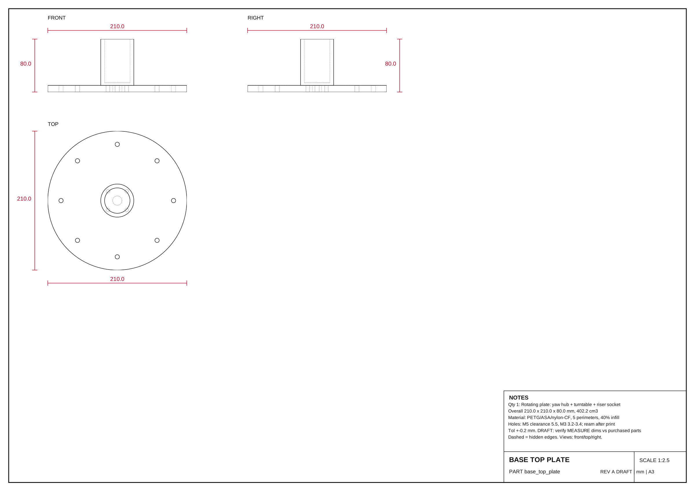](../../3d-workflow/design/drawings/base_top_plate.svg) |
| **elbow_cheek_motor**<br>Motor-side cheek plate | x1<br>[SVG](../../3d-workflow/design/drawings/elbow_cheek_motor.svg) · [PNG](../../3d-workflow/design/png/elbow_cheek_motor.png) · [STEP](../../3d-workflow/design/cad/step/elbow_cheek_motor.step) · [STL](../../3d-workflow/design/cad/stl/elbow_cheek_motor.stl) | [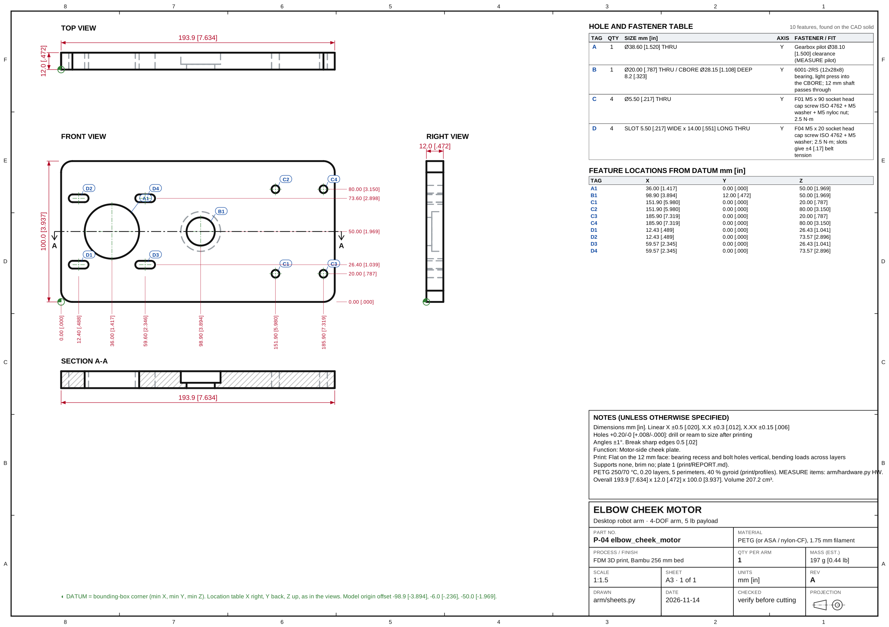](../../3d-workflow/design/drawings/elbow_cheek_motor.svg) |
| **elbow_cheek_plain**<br>Plain cheek plate | x1<br>[SVG](../../3d-workflow/design/drawings/elbow_cheek_plain.svg) · [PNG](../../3d-workflow/design/png/elbow_cheek_plain.png) · [STEP](../../3d-workflow/design/cad/step/elbow_cheek_plain.step) · [STL](../../3d-workflow/design/cad/stl/elbow_cheek_plain.stl) | [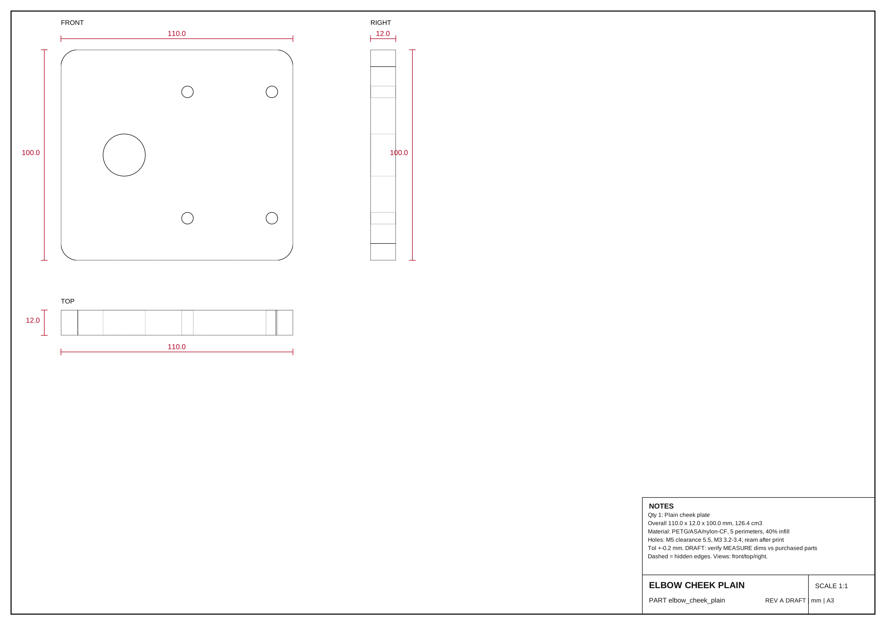](../../3d-workflow/design/drawings/elbow_cheek_plain.svg) |
| **elbow_tube_block**<br>Spacer block that clamps the incoming tube | x1<br>[SVG](../../3d-workflow/design/drawings/elbow_tube_block.svg) · [PNG](../../3d-workflow/design/png/elbow_tube_block.png) · [STEP](../../3d-workflow/design/cad/step/elbow_tube_block.step) · [STL](../../3d-workflow/design/cad/stl/elbow_tube_block.stl) | [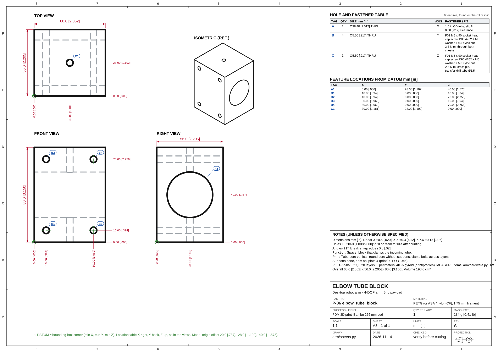](../../3d-workflow/design/drawings/elbow_tube_block.svg) |
| **gripper_adapter**<br>Tube-stub socket + plate bolting to gripper body (M4 heat-set inserts) | x1<br>[SVG](../../3d-workflow/design/drawings/gripper_adapter.svg) · [PNG](../../3d-workflow/design/png/gripper_adapter.png) · [STEP](../../3d-workflow/design/cad/step/gripper_adapter.step) · [STL](../../3d-workflow/design/cad/stl/gripper_adapter.stl) | [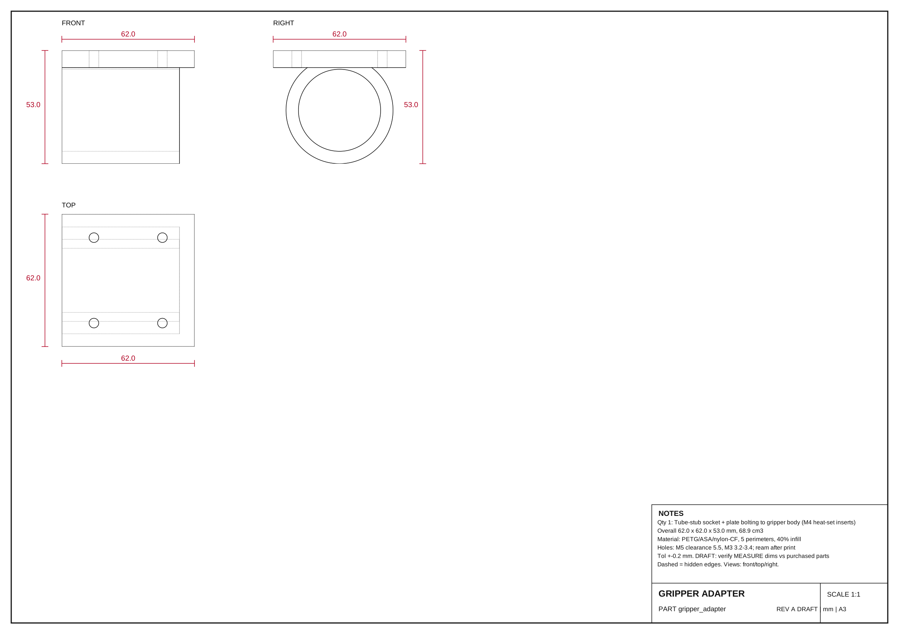](../../3d-workflow/design/drawings/gripper_adapter.svg) |
| **gripper_body**<br>NEMA17 lead-screw gripper body + fixed jaw | x1<br>[SVG](../../3d-workflow/design/drawings/gripper_body.svg) · [PNG](../../3d-workflow/design/png/gripper_body.png) · [STEP](../../3d-workflow/design/cad/step/gripper_body.step) · [STL](../../3d-workflow/design/cad/stl/gripper_body.stl) | [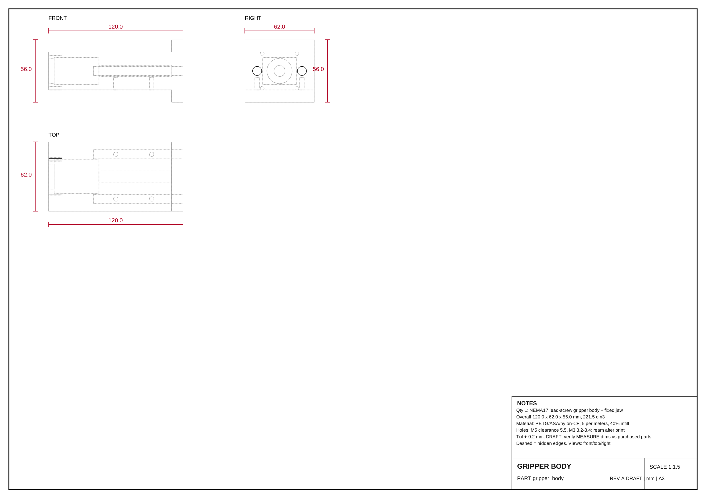](../../3d-workflow/design/drawings/gripper_body.svg) |
| **gripper_jaw**<br>Sliding jaw on 2x8 mm rods | x1<br>[SVG](../../3d-workflow/design/drawings/gripper_jaw.svg) · [PNG](../../3d-workflow/design/png/gripper_jaw.png) · [STEP](../../3d-workflow/design/cad/step/gripper_jaw.step) · [STL](../../3d-workflow/design/cad/stl/gripper_jaw.stl) | [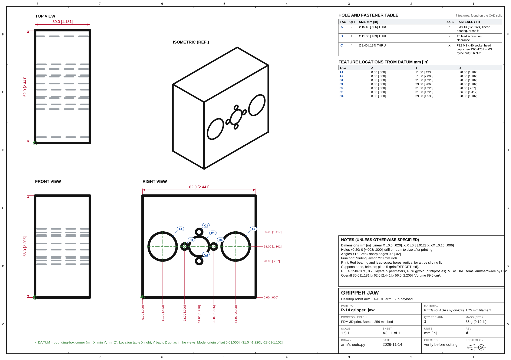](../../3d-workflow/design/drawings/gripper_jaw.svg) |
| **shoulder_cheek_motor**<br>Motor-side cheek plate | x1<br>[SVG](../../3d-workflow/design/drawings/shoulder_cheek_motor.svg) · [PNG](../../3d-workflow/design/png/shoulder_cheek_motor.png) · [STEP](../../3d-workflow/design/cad/step/shoulder_cheek_motor.step) · [STL](../../3d-workflow/design/cad/stl/shoulder_cheek_motor.stl) | [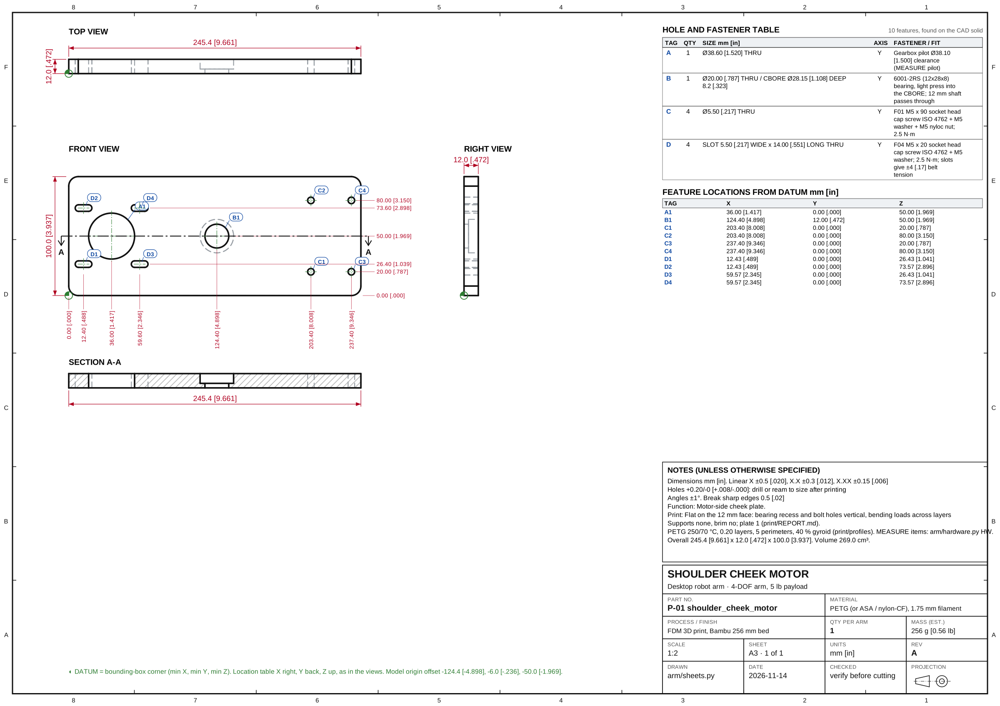](../../3d-workflow/design/drawings/shoulder_cheek_motor.svg) |
| **shoulder_cheek_plain**<br>Plain cheek plate | x1<br>[SVG](../../3d-workflow/design/drawings/shoulder_cheek_plain.svg) · [PNG](../../3d-workflow/design/png/shoulder_cheek_plain.png) · [STEP](../../3d-workflow/design/cad/step/shoulder_cheek_plain.step) · [STL](../../3d-workflow/design/cad/stl/shoulder_cheek_plain.stl) | [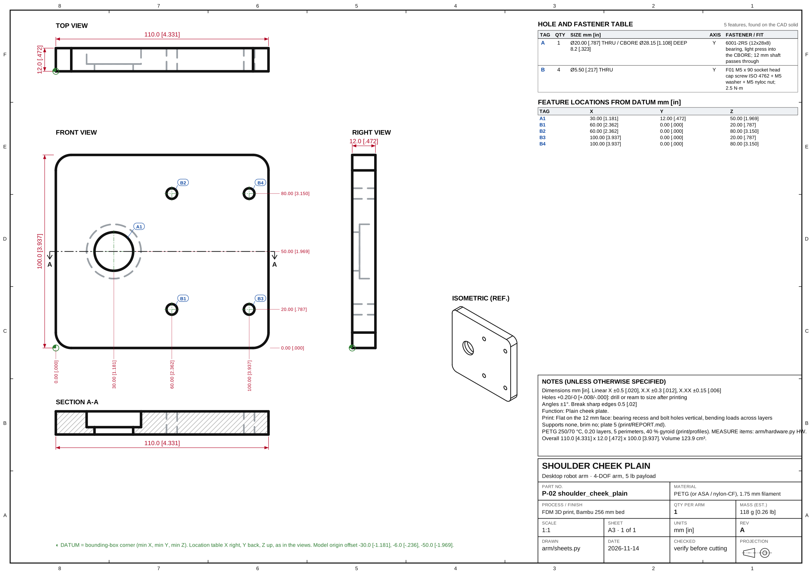](../../3d-workflow/design/drawings/shoulder_cheek_plain.svg) |
| **shoulder_tube_block**<br>Spacer block that clamps the incoming tube | x1<br>[SVG](../../3d-workflow/design/drawings/shoulder_tube_block.svg) · [PNG](../../3d-workflow/design/png/shoulder_tube_block.png) · [STEP](../../3d-workflow/design/cad/step/shoulder_tube_block.step) · [STL](../../3d-workflow/design/cad/stl/shoulder_tube_block.stl) | [](../../3d-workflow/design/drawings/shoulder_tube_block.svg) |
| **tube_socket**<br>Distal link end: hub flange + tube socket (shoulder, elbow, wrist) | x3<br>[SVG](../../3d-workflow/design/drawings/tube_socket.svg) · [PNG](../../3d-workflow/design/png/tube_socket.png) · [STEP](../../3d-workflow/design/cad/step/tube_socket.step) · [STL](../../3d-workflow/design/cad/stl/tube_socket.stl) | [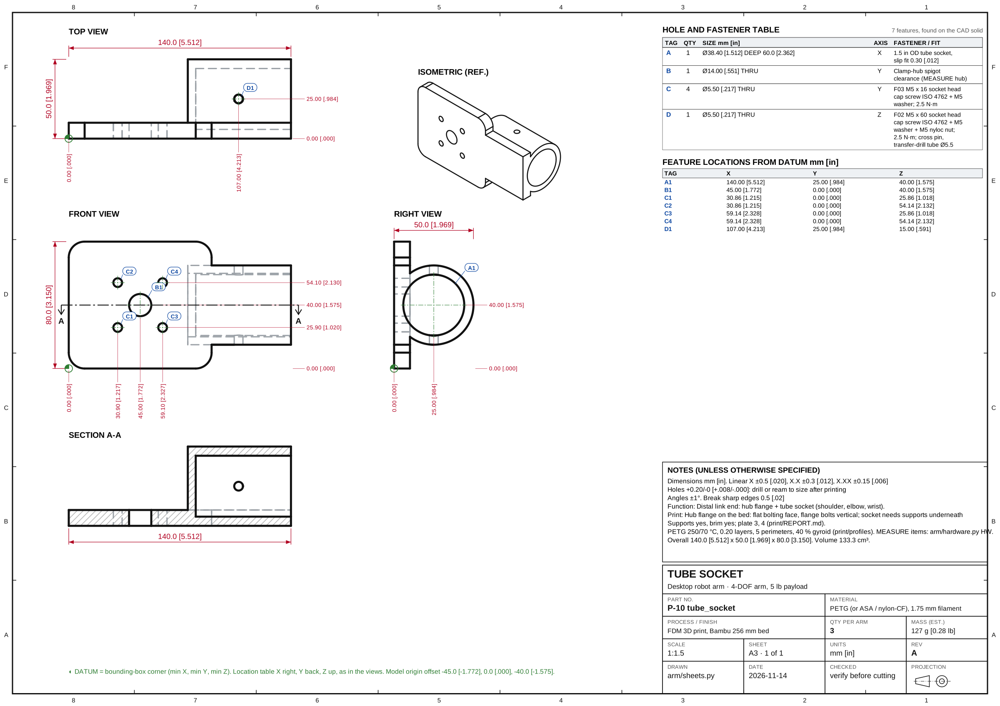](../../3d-workflow/design/drawings/tube_socket.svg) |
| **wrist_cheek_motor**<br>Motor-side cheek plate | x1<br>[SVG](../../3d-workflow/design/drawings/wrist_cheek_motor.svg) · [PNG](../../3d-workflow/design/png/wrist_cheek_motor.png) · [STEP](../../3d-workflow/design/cad/step/wrist_cheek_motor.step) · [STL](../../3d-workflow/design/cad/stl/wrist_cheek_motor.stl) | [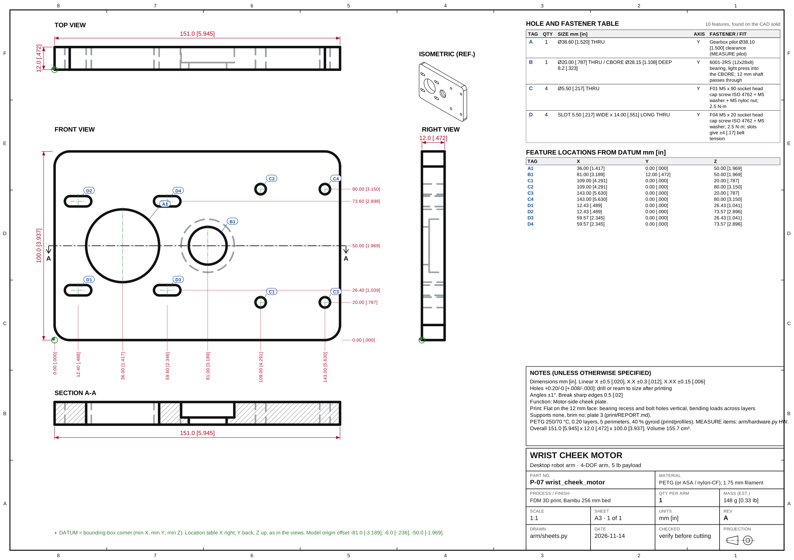](../../3d-workflow/design/drawings/wrist_cheek_motor.svg) |
| **wrist_cheek_plain**<br>Plain cheek plate | x1<br>[SVG](../../3d-workflow/design/drawings/wrist_cheek_plain.svg) · [PNG](../../3d-workflow/design/png/wrist_cheek_plain.png) · [STEP](../../3d-workflow/design/cad/step/wrist_cheek_plain.step) · [STL](../../3d-workflow/design/cad/stl/wrist_cheek_plain.stl) | [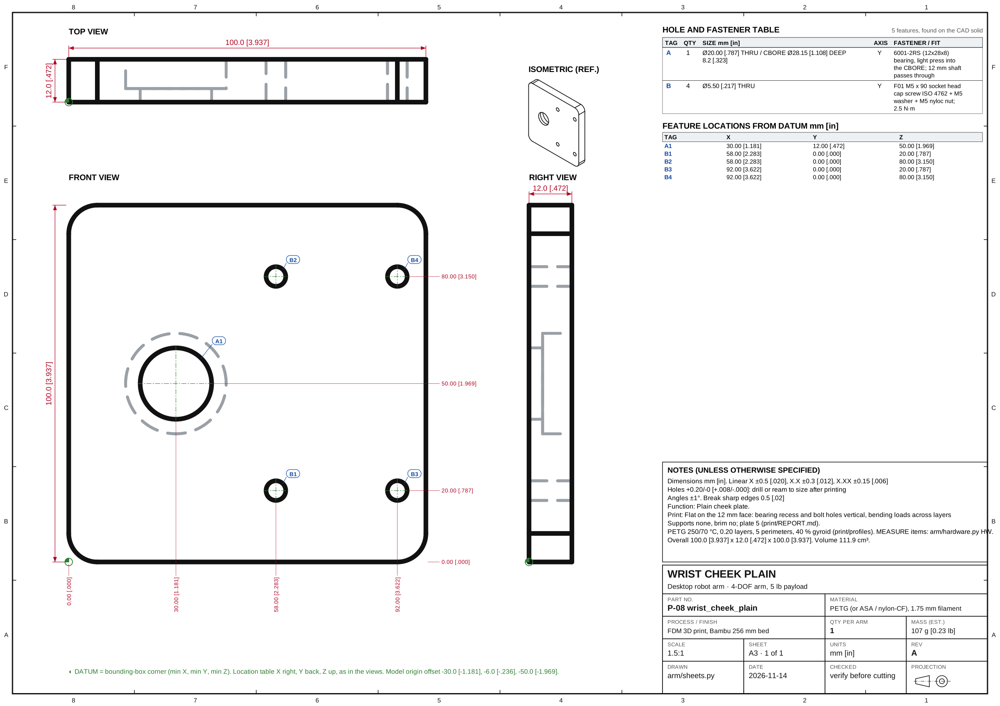](../../3d-workflow/design/drawings/wrist_cheek_plain.svg) |
| **wrist_tube_block**<br>Spacer block that clamps the incoming tube | x1<br>[SVG](../../3d-workflow/design/drawings/wrist_tube_block.svg) · [PNG](../../3d-workflow/design/png/wrist_tube_block.png) · [STEP](../../3d-workflow/design/cad/step/wrist_tube_block.step) · [STL](../../3d-workflow/design/cad/stl/wrist_tube_block.stl) | [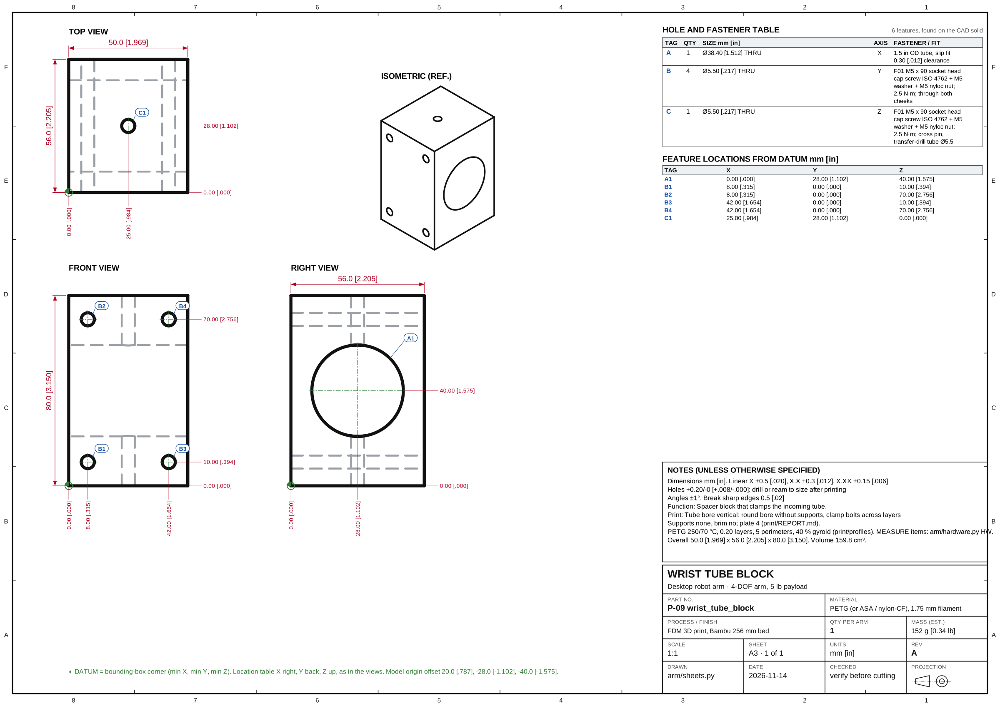](../../3d-workflow/design/drawings/wrist_tube_block.svg) |

## 3D control surface and virtual test table

`python run.py ui` opens a browser app ([`3d-workflow/control/`](../../3d-workflow/control)) that assembles every
printed STL with the purchased parts (gearmotors, pulleys, belts, bearings, shafts, hubs, tubes, turntable, gripper
NEMA17, rods) and the electronics bench (PSU, fuse, E-stop, Arduino Mega, five drivers, limit switches, live wiring).

- **Control:** joint sliders, IK target (typed or dragged in 3D), presets, teach-and-play, keyboard and gamepad jog.
- **Motors:** per channel pulses/rev and current (driver DIP), max speed, acceleration, limit-switch angle, direction;
  live step position, rate, rpm and the combined step-rate budget of the Mega.
- **Test:** payload slider, live gravity torque vs available torque per joint, automated sweep / worst-case /
  gripper / reach tests, pin and signal table.
- **Parts:** every BOM line with "in model / in BOM" counts, layer toggles, exploded view, click any part for its
  drawing and STL.
- **Link:** Web Serial to `firmware/arm_controller` (Chrome or Edge). Without hardware the same commands run against a
  simulated copy of the firmware, so you can rehearse a sequence before powering the arm.

Windows: after the setup above, `python run.py ui`, then open http://127.0.0.1:8765/control/index.html in Chrome or
Edge if it doesn't open by itself. Needs internet once for three.js (loaded from jsDelivr).

## Regenerating on Windows (your own terminal)

Tested in the cloud on Linux with Python 3.13 and CadQuery 2.8. The Windows steps below use the same commands;
the only Windows-specific parts are installing Python and a PNG renderer.

**1. One-time setup** (PowerShell, not as administrator):

```powershell
winget install -e --id Python.Python.3.12      # skip if `py -3.12 --version` already works
winget install -e --id Inkscape.Inkscape       # optional: PNG export (see step 3)
cd C:\path\to\Enumium\3d-workflow              # wherever you cloned the repo
py -3.12 -m venv .venv
.\.venv\Scripts\Activate.ps1                    # if blocked: Set-ExecutionPolicy -Scope CurrentUser RemoteSigned
python -m pip install --upgrade pip
python -m pip install -r requirements.txt
python run.py check                             # should print "ok" for Python, cadquery, pyserial
```

**2. Regenerate everything** (sizing, CAD, drawings, schematic, index, PNGs). Takes about a minute:

```powershell
.\.venv\Scripts\Activate.ps1
python run.py build
start design\index.html                         # opens the design package in your browser
```

**3. PNGs only** (after editing SVG-producing code, no CAD rebuild): `python run.py png`.
`arm/render.py` uses the first renderer it finds:

- **Inkscape** (simplest on Windows): installed by the winget line above, found on PATH or in `C:\Program Files\Inkscape`.
- **cairosvg**: `pip install cairosvg`. On Windows it also needs the Cairo DLL (for example from the GTK3 runtime
  installer) on PATH; if it is missing, the renderer is skipped automatically.
- **Playwright**: `pip install playwright` then `python -m playwright install chromium`.

If none is present, `build` still writes every SVG and prints how to enable PNGs.

**Changing the design:** measure your purchased gearboxes, hubs and turntable, set the `HW` values in
`3d-workflow/arm/hardware.py`, rerun `python run.py build`, then commit the changed files under `3d-workflow/design/`.
Other options: `python run.py ui` for the 3D control surface, `python -m arm.build --extension-m 1.219` for the full 4 ft reach, `python run.py sim` to check
kinematics without hardware, `python run.py console` to drive the real arm over USB.

## Status and limits

- DRAFT rev A. Part sheets show overall dimensions and projected geometry; hole sizes are in the sheet notes and in
  `arm/hardware.py`. ASM-001, ASM-002 and ELE-001 are schematic, not to scale.
- The parts depend on `HW` dimensions that must be measured on the purchased parts before printing.
- Gearbox ratings come from vendor listings; printed parts and firmware are unverified on real hardware.
- CI (`.github/workflows/design.yml`) runs the tests, regenerates the package and renders the PNGs on every push
  that touches `3d-workflow/`, and uploads them as a build artifact.
